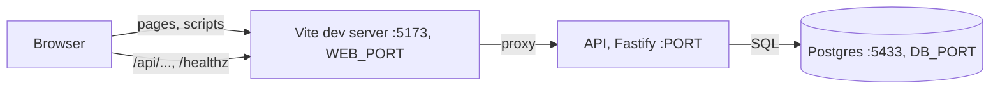

# Architecture

How the app is put together: the server, the web app, the database, and how they talk to each other.

## How the pieces talk

In development the browser talks only to Vite. Vite serves the web app and forwards `/api` and `/healthz` to the API at `http://localhost:${PORT}`, the same `PORT` setting the API listens on (`pnpm dev` checks the settings and passes the port to both). So the browser sees one origin: no CORS setup, and the web code calls relative paths such as `/api/lab-tests`. The proxy replaces what a reverse proxy or a server serving both would do in production; serving the built app from the API is out of scope for now (the reviewer runs the dev setup).

`pnpm dev` (`scripts/dev.ts`) starts it all: `.env` from `.env.example` when missing, the settings check, a check that the database URLs use `DB_PORT`, a Docker check, a check that the API's port (`PORT`, default 3000) and Vite's port (`WEB_PORT`, default 5173) are different and both free, `db:up`, `db:migrate`, `db:seed`, then `dev:api` and `dev:web` as two child processes with prefixed output (coloured only when the output is a terminal). Each failed check stops with one line. On Ctrl-C (or `SIGTERM`) the script sends `SIGTERM` to each child pnpm process, which passes it on to its script: the API gets it once, through `tsx watch`, and runs its graceful shutdown; Vite exits. A second Ctrl-C sends `SIGKILL` to each child's whole process group (each child runs in its own group, so this reaches pnpm, tsx and node), for when something hangs. If either child process exits, the other is stopped too. A crash of the API itself does not count: if the API crashes, `tsx watch` stays up waiting for a file change (saving the fix restarts it), so `pnpm dev` keeps running until Ctrl-C. Sending the first signal to the whole group, as an earlier version did, made the API get it twice (directly and through `tsx watch`), and tsx then force-killed it instead of letting it shut down.

## Web app

A React app in `src/web/`, built by Vite (`index.html` at the root loads `src/web/main.tsx`; `pnpm build` writes `dist/web`).

- **`main.tsx`** mounts, from the outside in: the error boundary, TanStack Query's `QueryClientProvider`, React Router's `BrowserRouter`, then `App`.
- **`App.tsx`** holds the routes: `/` Orders (the home page), `/patients`, `/patients/new`, `/catalog`, and `*` for "Page not found". All sit inside `Layout`, so the menu bar and the footer are on every page. Routing is declarative (`<Routes>`), not a data router: a data router has its own error screen, which would catch render errors before the app's error boundary.
- **`MenuBar.tsx`** uses `NavLink`, which gives the link of the current section `aria-current="page"`; the CSS styles that attribute, so the visual mark and what a screen reader hears cannot disagree. The "New order" button (LAB-20) goes at the end of the bar.
- **`api/client.ts`**: `apiFetch(path, { method, body, signal })` calls `fetch`, sends a body as JSON, and returns the parsed JSON body (or `undefined` for an empty one). On any failure it throws an `ApiError` with `status`, `code`, `message`, `details` and `requestId`, taken from the standard error body (checked with the shared schema in `src/shared/api-error.ts`). When there is no standard body (the network failed, the proxy answered 502 because the API is down, an HTML page, an empty body) it throws an `ApiError` with code `SERVER_UNREACHABLE`, the message "Can't reach the server. Try again." and no request id. A request cancelled through its `signal` ends with the abort, not an `ApiError`.
- **`api/errors.ts`**: `describeError(error)` gives the sentence to show: the server's message for a 4xx (the API writes those for the user), a generic message for a 5xx, "Can't reach the server. Try again." when unreachable, a generic message for anything that is not an `ApiError`; and it ends with "Reference: <requestId>" whenever there is one.
- **`api/query-client.ts`**: TanStack Query defaults: a query is retried once when the server could not be reached, never on a 4xx or 5xx; no refetch on window focus; a mutation is never retried.
- **`components/`**: `Loading` (text with `role="status"`), `EmptyState` (message and optional action), `ErrorMessage` (`describeError` text in a `role="alert"` box, with a "Try again" button when given `onRetry`), and `ErrorBoundary`. Every page shows loading, empty and error the same way, with the same wording and the same accessibility, and each new page gets them for free.
- **`ErrorBoundary`** catches an error thrown while rendering any component below it, writes it to the browser console and shows "Something went wrong. Reload the page." with a reload button, instead of a blank page. It does not catch a failed request (TanStack Query catches that and hands it to the page, which shows `ErrorMessage`), nor errors in event handlers, timers or other async code: React only sends render and lifecycle errors to a boundary.
- **`health/ServerStatus.tsx`** is a line in the footer that calls `GET /healthz` through `apiFetch` and TanStack Query: "Server: connected", or the error with a retry button. It is there so the proxy, the client and the error states are used for real before any feature page exists. A `503` from `/healthz` (database down) has no standard error body, so it also shows "Can't reach the server". A later task may keep it or remove it; nothing depends on it.
- **`patients/`**: the Patients list (`PatientsPage`, with the name search kept in the URL as `?q=`), the New patient page, the patient page (`PatientPage`, `/patients/:id`), and two components later screens reuse:
  - `PatientForm`: one form for create and edit. It takes the schema it checks with as a prop (`createPatientBody` on the New patient page, `updatePatientBody` on the patient page), the same shared schema the server parses with, so the rules exist once. It puts each problem, its own or one from the server's `details` (a 400, or the 422 `CONTACT_REQUIRED` of an edit), under the field it names. What differs between the two pages is outside the form: the New patient page sends the parsed values as they are (LAB-10 adds the duplicate warning there, to create only); the patient page fills the form with `toFormValues(patient)` (a null email or phone becomes an empty field) and sends only `changedFields(parsed, patient)`, the normalized values that differ from the stored ones, as a `PATCH`.
  - `PatientLabel`: the name with the date of birth ("Test Patient (born Mar 9, 1984)"), so two people with the same name can be told apart. Used as the patient page's heading, and by every later screen that names a patient (the New order patient picker in LAB-12, the orders filter in LAB-14). The Patients list shows the date of birth in its own column instead.
- **`styles/base.css`**: plain CSS, no component library: the theme (below), the shared classes every page uses, and a visible focus outline on everything focusable. The app is for a desktop browser window at least 1024 px wide; there is no mobile or narrow-screen layout and no breakpoints (an owner decision).
- **`styles/StylesPage.tsx`** is `/styles`, a page linked from nowhere in the menu that shows every shared style at once: the reference for building a page and the place to check the theme by eye.
- **`components/StatusBadge.tsx`** shows an order status as a tinted pill with the status word.

### Visual theme

The look is inspired by the palette of the company this exercise is for: a deep teal menu bar, a lime accent and a warm cream page. The app keeps its own name and uses no logo, no copied image or icon, and no font file.

**Colours** are CSS custom properties on `:root` in `src/web/styles/base.css`, named by role, not by hue, so a page never writes a colour value and a colour can change in one place. No hex value appears anywhere else under `src/web/`.

| Property | Value | Used for |
|---|---|---|
| `--color-brand-strong` | `#003438` | Menu bar, headings, table header text |
| `--color-brand` | `#004a50` | Primary buttons, links, the focus outline |
| `--color-accent` | `#dcff9f` | Current menu section, text on primary buttons |
| `--color-surface-tint` | `#ddf3ee` | Table header, row hover, the `ordered` badge |
| `--color-page` | `#fffaf2` | Page background, menu bar text |
| `--color-surface` | `#fffdf9` | Cards, tables, dialogs, fields |
| `--color-text` | `#451f41` | Body text |
| `--color-text-muted` | `#6b5a68` | Help text, footer, field outlines (chosen in LAB-24) |
| `--color-border` | `#e3d9cc` | Separators, decorative only (chosen in LAB-24) |
| `--color-danger` | `#a3221b` | Error text, danger buttons (chosen in LAB-24) |
| `--color-danger-surface` | `#fdeceb` | Error box, `cancelled` badge (chosen in LAB-24) |
| `--color-focus` | `var(--color-brand)` | Focus outline on light backgrounds |
| `--color-focus-on-brand` | `var(--color-accent)` | Focus outline in the menu bar |

**Type:** a system serif stack for headings and the brand name (`--font-heading`: Georgia, Iowan Old Style, Times New Roman), the system sans-serif stack for everything else (`--font-body`). Nothing is downloaded: the company's own typefaces are licensed and not used. **Spacing** is `--space-1` to `--space-5` (0.25 to 2 rem); **corners** are `--radius-control` (6 px, fields), `--radius-card` (12 px, cards, tables, dialogs) and `--radius-pill` (buttons, badges, menu links).

**Contrast.** Every pair the styles use, computed with the WCAG 2 relative-luminance formula. The rule: at least 4.5:1 for text, 3:1 for the focus outline and a field's outline against what is around them.

| Foreground | Background | Where | Ratio |
|---|---|---|---|
| text `#451f41` | page `#fffaf2` | Body text | 13.25 |
| text `#451f41` | surface `#fffdf9` | Text in cards, tables, dialogs, fields | 13.55 |
| text `#451f41` | surface-tint `#ddf3ee` | A hovered table row | 11.89 |
| text-muted `#6b5a68` | page `#fffaf2` | Footer, loading text, a locked (disabled) field | 6.15 |
| text-muted `#6b5a68` | surface `#fffdf9` | Help text in a card | 6.29 |
| text-muted `#6b5a68` | surface-tint `#ddf3ee` | A hovered inactive (dimmed) table row | 5.51 |
| brand-strong `#003438` | page `#fffaf2` | Headings | 13.05 |
| brand-strong `#003438` | surface `#fffdf9` | Headings in a card or dialog | 13.35 |
| brand-strong `#003438` | surface-tint `#ddf3ee` | Table header, `ordered` badge | 11.71 |
| brand-strong `#003438` | accent `#dcff9f` | Current menu section, `collected` badge | 12.17 |
| page `#fffaf2` | brand-strong `#003438` | Menu bar name and links | 13.05 |
| accent `#dcff9f` | brand `#004a50` | Primary button, `completed` badge | 9.00 |
| accent `#dcff9f` | brand-strong `#003438` | Hovered primary button (its label is also underlined) | 12.17 |
| brand `#004a50` | page `#fffaf2` | Links | 9.64 |
| brand `#004a50` | surface `#fffdf9` | Secondary button | 9.86 |
| brand `#004a50` | surface-tint `#ddf3ee` | Hovered secondary button | 8.65 |
| danger `#a3221b` | danger-surface `#fdeceb` | Error box, `cancelled` badge, hovered danger button | 6.56 |
| danger `#a3221b` | surface `#fffdf9` | A field's error message in a card | 7.38 |
| danger `#a3221b` | page `#fffaf2` | A field's error message on the page | 7.21 |
| surface `#fffdf9` | danger `#a3221b` | Danger button | 7.38 |
| focus outline, brand `#004a50` | page / surface / surface-tint / danger-surface | Focus anywhere outside the menu bar | 9.64 / 9.86 / 8.65 / 8.77 |
| focus outline, accent `#dcff9f` | brand-strong `#003438` | Focus in the menu bar | 12.17 |
| field outline, text-muted `#6b5a68` | surface `#fffdf9` | The border of an input or select | 6.29 |

Pairs deliberately not used: **lime on cream** (accent on page 1.07, on surface 1.10). The accent is never text or an outline on a light background; it is only a background under dark text, or text and outline on the teals. The focus outline was orange before this theme; orange on the teal menu bar is 2.62, so the outline is teal on light backgrounds and lime in the menu bar. `--color-border` on the page is 1.34: it is used only for separators, never as the only edge of a control. A disabled button is drawn at half opacity; WCAG exempts disabled controls from the contrast rule.

**Status badges** (`ordered`, `collected`, `completed`, `cancelled`) each have their own tint from the palette (surface-tint, accent, brand, danger-surface) and always show the status word, so colour is never the only signal.

TypeScript uses one `tsconfig.json` for both sides, with `DOM` in `lib` and the Node and `vite/client` types: Node types are visible in web code, the accepted cost of a single config. ESLint gives `src/web` browser globals and everything else Node globals; in TypeScript files the type checker is what catches an unknown global (typescript-eslint turns `no-undef` off there), so the split matters mostly for the plain JavaScript files.

## Server

A Fastify app in `src/server/`, run under `tsx` (`pnpm dev:api` in development, `pnpm start` otherwise). Plain `node` is not used, because imports are extensionless.

- **`app.ts`** exports `buildApp({ pool, clock, clinicTimezone, logger })`, which builds the app and returns it without listening. These four are its only dependencies: production passes the real pool, `() => new Date()`, `CLINIC_TIMEZONE` and the pino logger; tests pass a test-database pool, a fixed clock, `America/Denver` and a logger that captures lines, and call `app.inject()` with no network. A rule that needs "today" computes it as `today(clinicTimezone, clock())`, so a test can put the clock just before midnight in the clinic. `buildApp` sets up the request id, the request log line, the error handler and the 404 handler, then adds the routes: `/healthz`, then each feature's routes function (`catalogRoutes`, `patientRoutes`, ...), which writes its full `/api/...` paths. The routes are added to the app directly, not as a plugin registered with a `prefix`: Fastify closes registered plugins before it runs the app's `preClose` hook, so the shutdown flag below would be set a few ticks late and a request arriving in between would run instead of getting the 503.
- **`main.ts`** is the entry point: it loads the settings (`config.ts`), creates the logger and the pool, builds the app and listens on `PORT` (on `localhost`). On `SIGTERM` or `SIGINT` it logs `app.shutting_down` and closes the app: in-flight requests run to the end, and any request that arrives during shutdown (on an open connection or a new one) is not run and gets a 503 `SERVICE_UNAVAILABLE` in the standard error shape (Fastify's own 503 body is switched off). When the in-flight requests are done it closes the pool and exits 0. A repeated signal (a second Ctrl-C, or SIGTERM sent twice) is ignored. If requests are still running after 10 seconds it logs `app.shutdown_timeout` and exits 1.
- **Features** each get a folder, `src/server/<feature>/`, with `routes.ts`, `repo.ts`, `domain/` and, where needed, `service.ts` (see `AGENTS.md`). `health/routes.ts` is the first.
- **`errors.ts`** holds the typed errors (`ValidationError` 400, `NotFoundError` 404, `ConflictError` 409, `BusinessRuleError` 422), the error-code registry `ERROR_CODES`, and `toErrorResponse`, the one function that turns anything thrown into a status and the standard error body (see `docs/api.md`). The error handler in `app.ts` calls it for every error, including Fastify's own (malformed JSON, a body over 1 MiB, a body that is not JSON, a malformed URL), each of which gets a fixed message so nothing from the request is echoed back. Anything it does not recognise becomes a 500 with a generic message.
- **`parse.ts`** has `parse(schema, input)`: each route calls it explicitly on its body, params or query, and gets the parsed value or a `ValidationError` with one detail per field.
- **`request-id.ts`** picks the request id (see `docs/api.md`).
- **`logger.ts`** creates the pino logger (see Logging below).
- **`db/query.ts`** has `withQueryLog(poolOrClient, request.log)`, which repositories run their SQL through, so each query logs its duration.
- **`testing/`** is the integration test harness (see `docs/testing.md`).

### A request through a feature folder

The catalog (LAB-06) is the first feature and the pattern the others copy. `POST /api/lab-tests` with `{ "code": "demo-09", "name": "Demo Panel", "priceCents": 1999, "turnaroundDays": 2 }`:

1. **Screen** (`src/web/catalog/AddLabTestForm.tsx`). The user types a price in dollars, `19.99`. On submit the form turns it into cents with `parseDollarsToCents` (`src/shared/money.ts`, text handling, never floating point) and checks the whole body with the shared schema `createLabTestBody` (`src/shared/lab-tests.ts`). If a field is wrong, its message appears under it and nothing is sent. Otherwise a TanStack Query mutation calls `createLabTest` (`src/web/catalog/api.ts`), which sends the parsed body (code already `DEMO-09`) through `apiFetch` and checks the reply with `labTestSchema`.
2. **Route** (`src/server/catalog/routes.ts`). `parse(createLabTestBody, request.body)` checks the body again with the same schema: the server never trusts the browser. A bad body is a 400 `VALIDATION_ERROR` with one detail per field.
3. **Repository** (`src/server/catalog/repo.ts`). One `insert ... returning`, run through `withQueryLog(pool, request.log)`. The row goes through the typed mapper `toLabTest`, which checks it with `labTestSchema`, so a missing column fails loudly. A unique violation on `lab_tests_code_key` becomes `ConflictError('DUPLICATE_TEST_CODE')`, a 409.
4. **Database** (`db/migrations/0002_lab_tests.sql`). The unique constraint decides duplicates (two simultaneous requests cannot both win), and check constraints repeat the price, turnaround and code rules.
5. **Back up.** The route logs `lab_test.created` with the new id and answers 201. The form clears and invalidates the `['lab-tests']` query, so the list is fetched again and shows `DEMO-09`, `$19.99` (`formatCents`), "2 business days", without a reload.

There is no `service.ts` and no `domain/` here: the feature has no transaction and no rule beyond what the schema and the database enforce. A feature gets a service when it needs a transaction or combines rules with several queries (placing an order, LAB-12).

## Logging

The server logs with pino. `LOG_LEVEL` sets the level (`info` by default). Each line is one JSON object on standard output; `pnpm dev:api` sets `NODE_ENV=development`, and only then are lines printed readable and coloured by `pino-pretty`, which is a dev dependency.

### The logging standard

| Level | Used for | Examples |
|---|---|---|
| `debug` | Detail for a developer following one request; off by default, switched on by a setting (`LOG_LEVEL=debug`) | Which rule matched; the inputs and result of a calculation; a query's duration |
| `info` | Things that happened, one line each | Request finished (method, route pattern, status, duration); order created; status changed; app started; app shutting down |
| `warn` | A request refused for an expected reason, or something odd but handled | Validation failure; illegal status move; lost race; duplicate code |
| `error` | Something unexpected broke | Unhandled exception with its stack trace; database unreachable; startup config invalid |

Rules for every line:

- Lines are structured JSON with the request id (`requestId`), so all lines for one request can be pulled together. Readable coloured output is for development only.
- Business events have a stable dotted name in `event` (`order.created`) and carry ids and counts, never names, dates of birth, contact details or search text.
- An error message says what failed, on which record id, and why.
- The user sees a clear message and the request id; the stack trace stays in the server log.
- Each event is logged once, at the place it is handled, not at every layer it passes through.

### What the server logs

| Event | Level | Fields | Where |
|---|---|---|---|
| `request.completed` | `info` | `method`, `route`, `statusCode`, `durationMs` | Once per request, `app.ts`. `route` is the route pattern (`/api/patients/:id`), never the raw URL; a path that matches no route is logged as `(unmatched)`. |
| `request.rejected` | `warn` | `code`, `statusCode`, `fieldCount` (how many fields were invalid; not their names, which can be keys the client chose) | The error handler, for every 4xx error. |
| `request.failed` | `error` | `err` (type, message, code, stack; for a Postgres error, code and schema names but no message) | The error handler, for every 500. |
| `health.db_unavailable` | `error` | `code` (the error code only) | `/healthz` when the database does not answer. |
| `lab_test.created` | `info` | `labTestId` | `POST /api/lab-tests`, after the insert. |
| `lab_test.duplicate_code` | `warn` | none (never the code) | `POST /api/lab-tests`, when the code already exists. |
| `db.query` | `debug` | `command` (`SELECT`, ...), `rowCount`, `durationMs` | `withQueryLog`, once per query. |
| `db.pool_error` | `error` | `code` | The pool, when an idle connection breaks. |
| `patient.created` | `info` | `patientId` | `POST /api/patients`. Nothing else about the patient; a rejected body is the `request.rejected` line, with a field count only. |
| `patient.updated` | `info` | `patientId`, `changedFields` (the names of the fields the request set, such as `["phone"]`, never their values) | `PATCH /api/patients/:id`. A 422 `CONTACT_REQUIRED` is the `request.rejected` line. |
| `patient.search` | `debug` | `hasQuery`, `resultCount` | `GET /api/patients`. Never the search text: it is something a user typed about a patient. |
| `app.started`, `app.shutting_down` | `info` | `port`, `signal` | `main.ts`. |
| `app.start_failed`, `app.shutdown_timeout`, `app.shutdown_failed` | `error` | `err`, `capMs` | `main.ts`. |
| `config.invalid` | `error` | `problems` | `config.ts`, before the logger exists. |

Never logged: request bodies, query strings, headers, the raw URL, SQL text or parameters, and rows. An error's `err` field keeps only its type, message, code and stack, because other properties can repeat row values. A Postgres error is logged as `type: "DatabaseError"` with its SQLSTATE `code`, the schema names `constraint`, `table` and `column`, and a stack whose first line is `DatabaseError <code>` instead of the message: its message can repeat a submitted value (`invalid input syntax for type date: "..."`), and its `detail` repeats row values. Connection errors are logged by code only, because their messages name the database host. Lines carry no `pid` or `hostname`.

Fastify writes a few lines of its own with no `event` name: `Server listening at ...` once per address at startup (`app.started` says the same; Fastify has no option to turn these off), and, if a handler throws after its reply was sent, a line with the error. Neither holds request data.

## Database

- **Postgres 16 in Docker.** `compose.yaml` defines one service, `db`, published on host port **5433** (the `DB_PORT` setting) so it does not clash with a local Postgres on 5432. Data lives in the named volume `db-data`, so it survives `pnpm db:down`. A healthcheck (`pg_isready` over TCP) tells `pnpm db:up` when the server is ready.
- **Two databases on one server.** `lab_orders` is for development; `lab_orders_test` is for tests. The test database is created by `db/init/01-create-test-database.sql`, which Postgres runs once, when the volume is first created. The app reads `DATABASE_URL`; only the test tooling reads `TEST_DATABASE_URL`, and it refuses a database whose name does not end in `_test`.
- **Migrations** are plain SQL files in `db/migrations/`, applied in filename order by a small runner (`src/server/db/migrate.ts`). Each file runs in its own transaction together with the row that records it in `schema_migrations`, so a failing file leaves no partial change and is not recorded; the runner stops there. It refuses, before running it, a file with a line starting with its own `begin`/`commit`, a file not named `NNNN_description.sql`, two files with the same number, and a pending file older than the newest applied one. If a file ends the transaction some other way, a savepoint right after it fails, so the file is not recorded and the runner says to run `pnpm db:reset`. The project only rolls forward: there are no down migrations, and `pnpm db:reset` is the way back in development.
- **Seed data**: `db/seed.ts` runs the seed functions in `db/seeds/` in order (one file per table, for example `lab-tests.ts`) on one connection and prints the total inserted; every row has a fixed key and is inserted with `on conflict do nothing`.
- **Connections.** `createPool(url, logger)` in `src/server/db/pool.ts` creates the `pg` pool. It gives up on opening a connection after 5 seconds instead of waiting forever, and its `'error'` listener logs a broken idle connection (`db.pool_error`, the error code only) rather than ending the process. The database scripts use one connection each through `withClient` in `src/server/db/script.ts`. Both load the type parser in `src/server/db/types.ts`, which returns a Postgres `DATE` as its `YYYY-MM-DD` string.

## Settings

`src/server/config.ts` checks every setting with a Zod schema when a program starts and returns one typed, frozen object. If any setting is missing or invalid, it writes one JSON line at `error` level (`event: "config.invalid"`, with the list of problems) and exits with code 1. The line names the setting and the reason, never the value, because `DATABASE_URL` may hold a password.

| Setting | Default | Meaning |
|---|---|---|
| `DATABASE_URL` | (required) | Postgres connection string for the app's database. |
| `PORT` | `3000` | Port the API server listens on. |
| `WEB_PORT` | `5173` | Port the web app (Vite) listens on. Only `pnpm dev` and `vite.config.ts` use it. |
| `LOG_LEVEL` | `info` | `debug`, `info`, `warn` or `error`. |
| `CLINIC_TIMEZONE` | `America/Denver` | IANA time zone that decides what "today" is: the latest accepted date of birth, and the day an order was placed on. |

`TEST_DATABASE_URL` is not part of this config: only the test tooling reads it. Two more settings in `.env` are read by Docker Compose, not by this config: `DB_PORT` (default `5433`, the database's host port) and `COMPOSE_PROJECT_NAME` (default `lab-orders-lite`, which names the container and the data volume). `DATABASE_URL` and `TEST_DATABASE_URL` carry the port too, so `pnpm dev` and `pnpm test` stop with one line when a URL on `localhost` uses a different port from `DB_PORT` (`checkDatabasePort` in `src/server/db/guards.ts`): otherwise a second copy of the project could silently use the first copy's database. The same check runs in `db:migrate`, `db:seed`, `db:reset` and `db:test:reset`, and it also refuses a changed `DB_PORT` while `COMPOSE_PROJECT_NAME` is empty or still `lab-orders-lite`, because Compose would then recreate the first copy's container on the new port, with the first copy's data volume.
