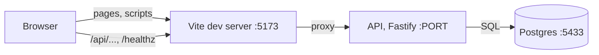

# Architecture

How the app is put together: the server, the web app, the database, and how they talk to each other.

## How the pieces talk

In development the browser talks only to Vite. Vite serves the web app and forwards `/api` and `/healthz` to the API at `http://localhost:${PORT}`, the same `PORT` setting the API listens on (`pnpm dev` checks the settings and passes the port to both). So the browser sees one origin: no CORS setup, and the web code calls relative paths such as `/api/lab-tests`. The proxy replaces what a reverse proxy or a server serving both would do in production; serving the built app from the API is out of scope for now (the reviewer runs the dev setup).

`pnpm dev` (`scripts/dev.ts`) starts it all: `.env` from `.env.example` when missing, the settings check, a Docker check, `db:up`, `db:migrate`, `db:seed`, then `dev:api` and `dev:web` as two child processes with prefixed output. Each child runs in its own process group; Ctrl-C (or `SIGTERM`) sends `SIGTERM` to both groups, so pnpm, tsx and node all stop and no process is left behind; a second Ctrl-C sends `SIGKILL`. If either child exits, the other is stopped. Under `tsx watch` the API is stopped at once rather than through its graceful shutdown (pnpm passes the signal on a second time, and tsx then force-kills it); that is fine in development, and `pnpm start` keeps the graceful shutdown.

## Web app

A React app in `src/web/`, built by Vite (`index.html` at the root loads `src/web/main.tsx`; `pnpm build` writes `dist/web`).

- **`main.tsx`** mounts, from the outside in: the error boundary, TanStack Query's `QueryClientProvider`, React Router's `BrowserRouter`, then `App`.
- **`App.tsx`** holds the routes: `/` Orders (the home page), `/patients`, `/catalog`, and `*` for "Page not found". All sit inside `Layout`, so the menu bar and the footer are on every page. Routing is declarative (`<Routes>`), not a data router: a data router has its own error screen, which would catch render errors before the app's error boundary.
- **`MenuBar.tsx`** uses `NavLink`, which gives the link of the current section `aria-current="page"`; the CSS styles that attribute, so the visual mark and what a screen reader hears cannot disagree. The "New order" button (LAB-20) goes at the end of the bar.
- **`api/client.ts`**: `apiFetch(path, { method, body, signal })` calls `fetch`, sends a body as JSON, and returns the parsed JSON body (or `undefined` for an empty one). On any failure it throws an `ApiError` with `status`, `code`, `message`, `details` and `requestId`, taken from the standard error body (checked with the shared schema in `src/shared/api-error.ts`). When there is no standard body (the network failed, the proxy answered 502 because the API is down, an HTML page, an empty body) it throws an `ApiError` with code `SERVER_UNREACHABLE`, the message "Can't reach the server. Try again." and no request id. A request cancelled through its `signal` ends with the abort, not an `ApiError`.
- **`api/errors.ts`**: `describeError(error)` gives the sentence to show: the server's message for a 4xx (the API writes those for the user), a generic message for a 5xx, "Can't reach the server. Try again." when unreachable, a generic message for anything that is not an `ApiError`; and it ends with "Reference: <requestId>" whenever there is one.
- **`api/query-client.ts`**: TanStack Query defaults: a query is retried once when the server could not be reached, never on a 4xx or 5xx; no refetch on window focus; a mutation is never retried.
- **`components/`**: `Loading` (text with `role="status"`), `EmptyState` (message and optional action), `ErrorMessage` (`describeError` text in a `role="alert"` box, with a "Try again" button when given `onRetry`), and `ErrorBoundary`. Every page shows loading, empty and error the same way, with the same wording and the same accessibility, and each new page gets them for free.
- **`ErrorBoundary`** catches an error thrown while rendering any component below it, writes it to the browser console and shows "Something went wrong. Reload the page." with a reload button, instead of a blank page. It does not catch a failed request (TanStack Query catches that and hands it to the page, which shows `ErrorMessage`), nor errors in event handlers, timers or other async code: React only sends render and lifecycle errors to a boundary.
- **`health/ServerStatus.tsx`** is a line in the footer that calls `GET /healthz` through `apiFetch` and TanStack Query: "Server: connected", or the error with a retry button. It is there so the proxy, the client and the error states are used for real before any feature page exists. A `503` from `/healthz` (database down) has no standard error body, so it also shows "Can't reach the server". A later task may keep it or remove it; nothing depends on it.
- **`styles/base.css`**: plain CSS, no component library: colour and spacing variables, system fonts, a visible focus outline on everything focusable, and a layout that works from 360 px wide (the menu bar wraps).

TypeScript uses one `tsconfig.json` for both sides, with `DOM` in `lib` and the Node and `vite/client` types: Node types are visible in web code, the accepted cost of a single config. ESLint gives `src/web` browser globals and everything else Node globals; in TypeScript files the type checker is what catches an unknown global (typescript-eslint turns `no-undef` off there), so the split matters mostly for the plain JavaScript files.

## Server

A Fastify app in `src/server/`, run under `tsx` (`pnpm dev:api` in development, `pnpm start` otherwise). Plain `node` is not used, because imports are extensionless.

- **`app.ts`** exports `buildApp({ pool, clock, logger })`, which builds the app and returns it without listening. These three are its only dependencies: production passes the real pool, `() => new Date()` and the pino logger; tests pass a test-database pool, a fixed clock and a logger that captures lines, and call `app.inject()` with no network. `buildApp` sets up the request id, the request log line, the error handler and the 404 handler, then registers the routes: `/healthz` now, and each feature's routes under the `/api` prefix from LAB-06.
- **`main.ts`** is the entry point: it loads the settings (`config.ts`), creates the logger and the pool, builds the app and listens on `PORT` (on `localhost`). On `SIGTERM` or `SIGINT` it logs `app.shutting_down` and closes the app: in-flight requests run to the end, and any request that arrives during shutdown (on an open connection or a new one) is not run and gets a 503 `SERVICE_UNAVAILABLE` in the standard error shape (Fastify's own 503 body is switched off). When the in-flight requests are done it closes the pool and exits 0. A repeated signal (a second Ctrl-C, or SIGTERM sent twice) is ignored. If requests are still running after 10 seconds it logs `app.shutdown_timeout` and exits 1.
- **Features** each get a folder, `src/server/<feature>/`, with `routes.ts`, `repo.ts`, `domain/` and, where needed, `service.ts` (see `AGENTS.md`). `health/routes.ts` is the first.
- **`errors.ts`** holds the typed errors (`ValidationError` 400, `NotFoundError` 404, `ConflictError` 409, `BusinessRuleError` 422), the error-code registry `ERROR_CODES`, and `toErrorResponse`, the one function that turns anything thrown into a status and the standard error body (see `docs/api.md`). The error handler in `app.ts` calls it for every error, including Fastify's own (malformed JSON, a body over 1 MiB, a body that is not JSON, a malformed URL), each of which gets a fixed message so nothing from the request is echoed back. Anything it does not recognise becomes a 500 with a generic message.
- **`parse.ts`** has `parse(schema, input)`: each route calls it explicitly on its body, params or query, and gets the parsed value or a `ValidationError` with one detail per field.
- **`request-id.ts`** picks the request id (see `docs/api.md`).
- **`logger.ts`** creates the pino logger (see Logging below).
- **`db/query.ts`** has `withQueryLog(poolOrClient, request.log)`, which repositories run their SQL through, so each query logs its duration.
- **`testing/`** is the integration test harness (see `docs/testing.md`).

## Logging

The server logs with pino. `LOG_LEVEL` sets the level (`info` by default). Each line is one JSON object on standard output; `pnpm dev:api` sets `NODE_ENV=development`, and only then are lines printed readable and coloured by `pino-pretty`, which is a dev dependency.

### The logging standard

| Level | Used for | Examples |
|---|---|---|
| `debug` | Detail for a developer following one request; off by default, switched on by a setting (`LOG_LEVEL=debug`) | Which rule matched; the inputs and result of a calculation; a query's duration |
| `info` | Things that happened, one line each | Request finished (method, route pattern, status, duration); order created; status changed; app started; app shutting down |
| `warn` | A request refused for an expected reason, or something odd but handled | Validation failure; illegal status move; lost race; duplicate code |
| `error` | Something unexpected broke | Unhandled exception with its stack trace; database unreachable; startup config invalid |

Rules for every line:

- Lines are structured JSON with the request id (`requestId`), so all lines for one request can be pulled together. Readable coloured output is for development only.
- Business events have a stable dotted name in `event` (`order.created`) and carry ids and counts, never names, dates of birth, contact details or search text.
- An error message says what failed, on which record id, and why.
- The user sees a clear message and the request id; the stack trace stays in the server log.
- Each event is logged once, at the place it is handled, not at every layer it passes through.

### What the server logs

| Event | Level | Fields | Where |
|---|---|---|---|
| `request.completed` | `info` | `method`, `route`, `statusCode`, `durationMs` | Once per request, `app.ts`. `route` is the route pattern (`/api/patients/:id`), never the raw URL; a path that matches no route is logged as `(unmatched)`. |
| `request.rejected` | `warn` | `code`, `statusCode`, `fieldCount` (how many fields were invalid; not their names, which can be keys the client chose) | The error handler, for every 4xx error. |
| `request.failed` | `error` | `err` (type, message, code, stack; for a Postgres error, code and schema names but no message) | The error handler, for every 500. |
| `health.db_unavailable` | `error` | `code` (the error code only) | `/healthz` when the database does not answer. |
| `db.query` | `debug` | `command` (`SELECT`, ...), `rowCount`, `durationMs` | `withQueryLog`, once per query. |
| `db.pool_error` | `error` | `code` | The pool, when an idle connection breaks. |
| `app.started`, `app.shutting_down` | `info` | `port`, `signal` | `main.ts`. |
| `app.start_failed`, `app.shutdown_timeout`, `app.shutdown_failed` | `error` | `err`, `capMs` | `main.ts`. |
| `config.invalid` | `error` | `problems` | `config.ts`, before the logger exists. |

Never logged: request bodies, query strings, headers, the raw URL, SQL text or parameters, and rows. An error's `err` field keeps only its type, message, code and stack, because other properties can repeat row values. A Postgres error is logged as `type: "DatabaseError"` with its SQLSTATE `code`, the schema names `constraint`, `table` and `column`, and a stack whose first line is `DatabaseError <code>` instead of the message: its message can repeat a submitted value (`invalid input syntax for type date: "..."`), and its `detail` repeats row values. Connection errors are logged by code only, because their messages name the database host. Lines carry no `pid` or `hostname`.

Fastify writes a few lines of its own with no `event` name: `Server listening at ...` once per address at startup (`app.started` says the same; Fastify has no option to turn these off), and, if a handler throws after its reply was sent, a line with the error. Neither holds request data.

## Database

- **Postgres 16 in Docker.** `compose.yaml` defines one service, `db`, published on host port **5433** so it does not clash with a local Postgres on 5432. Data lives in the named volume `db-data`, so it survives `pnpm db:down`. A healthcheck (`pg_isready` over TCP) tells `pnpm db:up` when the server is ready.
- **Two databases on one server.** `lab_orders` is for development; `lab_orders_test` is for tests. The test database is created by `db/init/01-create-test-database.sql`, which Postgres runs once, when the volume is first created. The app reads `DATABASE_URL`; only the test tooling reads `TEST_DATABASE_URL`, and it refuses a database whose name does not end in `_test`.
- **Migrations** are plain SQL files in `db/migrations/`, applied in filename order by a small runner (`src/server/db/migrate.ts`). Each file runs in its own transaction together with the row that records it in `schema_migrations`, so a failing file leaves no partial change and is not recorded; the runner stops there. It refuses, before running it, a file with a line starting with its own `begin`/`commit`, a file not named `NNNN_description.sql`, two files with the same number, and a pending file older than the newest applied one. If a file ends the transaction some other way, a savepoint right after it fails, so the file is not recorded and the runner says to run `pnpm db:reset`. The project only rolls forward: there are no down migrations, and `pnpm db:reset` is the way back in development.
- **Seed data** comes from `db/seed.ts`; every row has a fixed key and is inserted with `on conflict do nothing`.
- **Connections.** `createPool(url, logger)` in `src/server/db/pool.ts` creates the `pg` pool. It gives up on opening a connection after 5 seconds instead of waiting forever, and its `'error'` listener logs a broken idle connection (`db.pool_error`, the error code only) rather than ending the process. The database scripts use one connection each through `withClient` in `src/server/db/script.ts`. Both load the type parser in `src/server/db/types.ts`, which returns a Postgres `DATE` as its `YYYY-MM-DD` string.

## Settings

`src/server/config.ts` checks every setting with a Zod schema when a program starts and returns one typed, frozen object. If any setting is missing or invalid, it writes one JSON line at `error` level (`event: "config.invalid"`, with the list of problems) and exits with code 1. The line names the setting and the reason, never the value, because `DATABASE_URL` may hold a password.

| Setting | Default | Meaning |
|---|---|---|
| `DATABASE_URL` | (required) | Postgres connection string for the app's database. |
| `PORT` | `3000` | Port the API server listens on. |
| `LOG_LEVEL` | `info` | `debug`, `info`, `warn` or `error`. |
| `CLINIC_TIMEZONE` | `America/Denver` | IANA time zone that decides which calendar day an order was placed on. |

`TEST_DATABASE_URL` is not part of this config: only the test tooling reads it.
