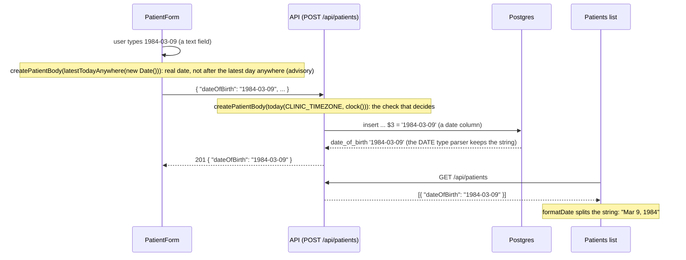

# Data flow

How a request travels from the screen to the database and back, shown for the main actions.

Kept up to date by each task that adds an action.

## An error, from the server to the screen

The path of a failed request, here a `ConflictError` thrown by the catalog repository (a duplicate lab test code, LAB-06), and what the user reads.

```mermaid
sequenceDiagram
  participant U as User
  participant P as Page (React)
  participant Q as TanStack Query
  participant C as apiFetch
  participant V as Vite proxy
  participant A as API (Fastify)

  U->>P: submits the form
  P->>Q: mutate
  Q->>C: apiFetch('/api/lab-tests', { method: 'POST', body })
  C->>V: POST /api/lab-tests
  V->>A: POST /api/lab-tests
  Note over A: onRequest: request id taken from x-request-id or a new UUID
  A->>A: insert hits the unique constraint (23505), repo throws ConflictError('DUPLICATE_TEST_CODE', 'This code already exists')
  Note over A: route: warn line lab_test.duplicate_code; error handler: toErrorResponse, warn line request.rejected
  A-->>V: 409 { error: { code, message, requestId } }
  V-->>C: 409, same body
  Note over C: body matches errorBodySchema (src/shared)
  C-->>Q: throws ApiError(409, code, message, requestId)
  Q-->>P: error (a mutation is never retried)
  P->>P: the form puts error.message under the Code field
  P-->>U: "This code already exists" under Code
```

The add form shows a 409 `DUPLICATE_TEST_CODE` and a 400's `details` under their fields; any other failure is shown above its button by `ErrorMessage` with `describeError`, which ends with "Reference: <requestId>". The list on the page shows a failed load the same way, with a "Try again" button.

- **Where the request id comes from:** the API picks it for every request (the caller's `x-request-id` when it is sane, otherwise a new UUID), puts it on every log line for the request and in the error body. The user quotes the reference; a developer finds the matching log lines with it.
- **When the API is down:** the proxy answers `502` with no standard body, so `apiFetch` throws `ApiError` with code `SERVER_UNREACHABLE`; a query retries once, then the page shows "Can't reach the server. Try again." with no reference (there is no request id, because the API never saw the request).
- **A 500:** the body is in the standard shape with the generic message; `describeError` shows "Something went wrong on the server. Try again. Reference: <id>", and the stack is only in the server log under that id.
- **A render error** (a bug in a component) never reaches this path: the error boundary shows "Something went wrong. Reload the page."

## A date of birth, from the form to the database and back

A date of birth is a calendar day and stays a `YYYY-MM-DD` string at every step; nothing on the way builds a JavaScript `Date` from it.



- **"Today" is the clinic's.** The server asks `today(CLINIC_TIMEZONE, clock())`, so a date of birth of the clinic's today is accepted even when it is already tomorrow in UTC, and the clinic's tomorrow is refused. The browser does not know the clinic's time zone, so it checks against the latest day anywhere on Earth (`latestTodayAnywhere`, UTC+14): it catches a date that is plainly in the future, never blocks one the clinic accepts, and the server's answer wins.
- **A rejected value goes back as a field problem**, `{ field: "dateOfBirth", reason: "..." }` in `details`, and the form shows it under the date of birth. The value itself is never logged.
