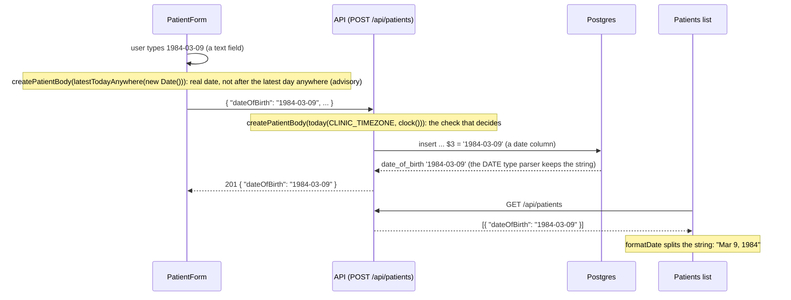
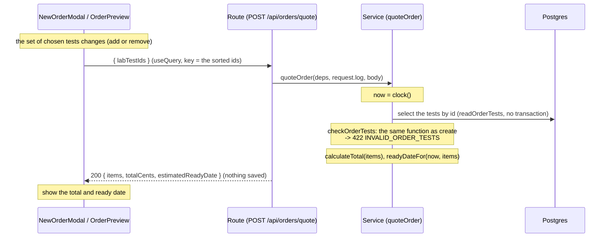

# Data flow

How a request travels from the screen to the database and back, shown for the main actions.

Kept up to date by each task that adds an action.

## An error, from the server to the screen

The path of a failed request, here a `ConflictError` thrown by the catalog repository (a duplicate lab test code, LAB-06), and what the user reads.

```mermaid
sequenceDiagram
  participant U as User
  participant P as Page (React)
  participant Q as TanStack Query
  participant C as apiFetch
  participant V as Vite proxy
  participant A as API (Fastify)

  U->>P: submits the form
  P->>Q: mutate
  Q->>C: apiFetch('/api/lab-tests', { method: 'POST', body })
  C->>V: POST /api/lab-tests
  V->>A: POST /api/lab-tests
  Note over A: onRequest: request id taken from x-request-id or a new UUID
  A->>A: insert hits the unique constraint (23505), repo throws ConflictError('DUPLICATE_TEST_CODE', 'This code already exists')
  Note over A: route: warn line lab_test.duplicate_code; error handler: toErrorResponse, warn line request.rejected
  A-->>V: 409 { error: { code, message, requestId } }
  V-->>C: 409, same body
  Note over C: body matches errorBodySchema (src/shared)
  C-->>Q: throws ApiError(409, code, message, requestId)
  Q-->>P: error (a mutation is never retried)
  P->>P: the form puts error.message under the Code field
  P-->>U: "This code already exists" under Code
```

The add form shows a 409 `DUPLICATE_TEST_CODE` and a 400's `details` under their fields; any other failure is shown above its button by `ErrorMessage` with `describeError`, which ends with "Reference: <requestId>". The list on the page shows a failed load the same way, with a "Try again" button.

- **Where the request id comes from:** the API picks it for every request (the caller's `x-request-id` when it is sane, otherwise a new UUID), puts it on every log line for the request and in the error body. The user quotes the reference; a developer finds the matching log lines with it.
- **When the API is down:** the proxy answers `502` with no standard body, so `apiFetch` throws `ApiError` with code `SERVER_UNREACHABLE`; a query retries once, then the page shows "Can't reach the server. Try again." with no reference (there is no request id, because the API never saw the request).
- **A 500:** the body is in the standard shape with the generic message; `describeError` shows "Something went wrong on the server. Try again. Reference: <id>", and the stack is only in the server log under that id.
- **A render error** (a bug in a component) never reaches this path: the error boundary shows "Something went wrong. Reload the page."

## A date of birth, from the form to the database and back

A date of birth is a calendar day and stays a `YYYY-MM-DD` string at every step; nothing on the way builds a JavaScript `Date` from it.



- **"Today" is the clinic's.** The server asks `today(CLINIC_TIMEZONE, clock())`, so a date of birth of the clinic's today is accepted even when it is already tomorrow in UTC, and the clinic's tomorrow is refused. The browser does not know the clinic's time zone, so it checks against the latest day anywhere on Earth (`latestTodayAnywhere`, UTC+14): it catches a date that is plainly in the future, never blocks one the clinic accepts, and the server's answer wins.
- **A rejected value goes back as a field problem**, `{ field: "dateOfBirth", reason: "..." }` in `details`, and the form shows it under the date of birth. The value itself is never logged.

## A new patient, through the duplicate check

`POST /api/patients` (LAB-10). The body is parsed first, so a bad body is a 400 and is never reported as a duplicate. Then the patients service runs the check, unless the body says `confirmDuplicate: true`.

```mermaid
sequenceDiagram
  participant F as NewPatientPage
  participant A as API (route, then patients service)
  participant D as Postgres

  F->>A: POST { firstName, lastName, dateOfBirth, email, phone }
  Note over A: parse(createPatientBody): 400 VALIDATION_ERROR if wrong
  A->>D: findDuplicateCandidates: lower(email) = $1 or phone = $2 or (names, date of birth), no limit
  D-->>A: candidate rows
  Note over A: matchRules(body, row) for each: email, phone, name_dob; keep the matches, list the first 10
  alt at least one match
    Note over A: warn patient.possible_duplicate (count, rule names); debug the ids
    A-->>F: 409 POSSIBLE_DUPLICATE, error.matches, nothing inserted
    Note over F: DuplicateWarning above the form, which keeps its values
    alt Open this patient
      F->>F: go to /patients/:id (nothing created)
    else Create anyway
      F->>A: the same body plus confirmDuplicate: true
      A->>D: insert (no check)
      A-->>F: 201, info patient.created duplicateConfirmed: true
    else the user edits a field
      Note over F: the warning goes away; the next Save checks again
    end
  else no match
    A->>D: insert
    A-->>F: 201, info patient.created
  end
```

The check and the insert are two statements with no lock between them, so two identical creates sent at the same moment can both pass the check and both insert. That is accepted for this version: the rule warns, it does not guarantee. Editing a patient (`PATCH`) skips all of this.

## The orders list, from the database to the home page

`GET /api/orders` (LAB-11) in one query, and the two derived values on the way.

```mermaid
sequenceDiagram
  participant P as OrdersPage
  participant A as API (GET /api/orders)
  participant D as Postgres

  P->>A: GET /api/orders (TanStack Query, key ['orders'])
  A->>D: one select: orders join patients, left join order_items,<br/>array_agg(price_cents) per order, newest first, id breaks ties
  D-->>A: one row per order with item_prices [2500, 3800]
  Note over A: toOrderListItem: testCount = item_prices.length,<br/>totalCents = calculateTotal(item_prices),<br/>createdAtClinic = clinicDateTime(CLINIC_TIMEZONE, created_at)
  A-->>P: { items, hasMore: false, clinicTimezone }
  Note over P: orderListSchema.parse; PatientLabel, formatCents,<br/>formatDate, StatusBadge, formatDateTime(createdAtClinic)
```

- **One query, however many orders.** The patient comes by a join and the item prices as one array per order, so there is no query per row.
- **The total is worked out here, every time,** by `calculateTotal` on the frozen item prices; the database has no total column and the SQL has no `SUM`. The ready date is read as stored: it was worked out once, when the order was placed.
- **The created time is formatted on the server** in `CLINIC_TIMEZONE` and shown as sent, so a browser in another time zone still shows the clinic's time, and the column header names the zone.
- **Nothing about a patient is logged:** the request line (`request.completed`) and one `db.query` debug line are all.

## One order, from the database to the panel

`GET /api/orders/:id` (LAB-15), opened from a row or from `?order=<id>` in the address.

```mermaid
sequenceDiagram
  participant P as OrderDetailPanel
  participant A as API (GET /api/orders/:id)
  participant D as Postgres

  P->>A: GET /api/orders/<id> (TanStack Query, key ['orders', id])
  A->>D: select the order joined to its patient
  D-->>A: one row, or none (404 NOT_FOUND)
  A->>D: select the order_items rows of the order
  D-->>A: code, name, price, turnaround per item
  Note over A: totalCents = calculateTotal(items),<br/>allowedNextStatuses and canCancel from the transition table,<br/>createdAtClinic = clinicDateTime(CLINIC_TIMEZONE, created_at)
  A-->>P: the order
  Note over P: orderDetailSchema.parse; StatusBadge, PatientLabel,<br/>formatCents, formatDate, formatDateTime(createdAtClinic)
```

- **Two reads, no catalog.** The items are the frozen `order_items` rows, so a later price change in the catalog cannot change what the panel shows.
- **The id is checked before the database.** A string that is not a uuid is a 400 and never reaches Postgres; a well-formed id with no order is a 404. The panel does not even ask for an address that is not a uuid: it shows "Order not found".
- **The panel's state is in the address.** Clicking a row adds `?order=<id>` (a history entry); the page renders the panel while it is there, and closing or going back removes it.
- **Nothing about the patient is logged:** the request line, a `db.query` line per query, and `order.loaded` with the id and the item count.

## Placing an order, from the modal to the database

`POST /api/orders` (LAB-12): the New order modal, the service and its one transaction.

```mermaid
sequenceDiagram
  participant M as NewOrderModal
  participant R as Route (POST /api/orders)
  participant S as Service (createOrder)
  participant D as Postgres

  Note over M: patient from usePatientSearch, tests from the catalog<br/>(GET /api/lab-tests) through matchTests
  M->>R: { patientId, labTestIds } (useMutation)
  Note over R: parse(createOrderBody): 400 for a missing field,<br/>a non-uuid id or an unknown field
  R->>S: createOrder(deps, request.log, body)
  Note over S: now = clock(), read once
  S->>D: begin
  S->>D: select the tests by id ... for share
  Note over S: checkOrderTests: empty, repeated, unknown, inactive<br/>-> 422 INVALID_ORDER_TESTS (rollback, nothing saved)
  Note over S: estimateReadyDate(now, tests, CLINIC_TIMEZONE)
  S->>D: insert order (status ordered, ready date, created_at = now)
  Note over D: patient foreign key fails -> 422 UNKNOWN_PATIENT (rollback)
  S->>D: insert one item per test (code, name, price, turnaround copied)
  S->>D: read the order back as a list row
  S->>D: commit
  R-->>M: 201 the list row (total from calculateTotal); log order.created
  Note over M: close; invalidate ['orders'], so the list shows it first
```

- **All or nothing.** The catalog read, the order and its items run on one connection in one transaction. A refusal or any failure (a constraint on an item, a lost connection) rolls everything back: there is never an order without all of its items.
- **The server is the authority.** The modal's catalog may be stale. The tests are read again inside the transaction and locked (`FOR SHARE`) until it commits, so a test deactivated after the modal loaded is refused, and a price change sent at the same moment waits until the order is saved.
- **A snapshot.** Each item copies the test's code, name, price and turnaround. Changing or deactivating the test later never changes the order, its total or its ready date.
- **One `now`.** The clock is read once; the same instant is `created_at` and the moment the ready date counts from.
- **On a refusal** the modal stays open with the patient and the tests as they were, and shows the server's message with the request id (`ErrorMessage`).

## The live total and ready date, while building an order

`POST /api/orders/quote` (LAB-13): the summary under the chosen tests in the New order modal.



- **Nothing is calculated in the browser.** The summary shows what the server sent; the rules live in `domain/total.ts` and `domain/ready-date.ts` only.
- **One request per change of the chosen tests**, none while typing in quick-add, none with no tests (the summary says "Add a test to see the total").
- **While a new quote loads**, the previous numbers stay but are dimmed and marked "Updating…", so they are not read as current.
- **A failed quote** shows a quiet line with the request id. "Submit order" stays usable: the server recalculates on submit and decides.
- **Preview equals saved** when placed at the same moment: both call `checkOrderTests`, `calculateTotal` and `readyDateFor` with the same clock and clinic time zone. If the day rolls over between the preview and the submit, the saved order has the later date.

## Changing an order's status, from the panel to the database

`POST /api/orders/:id/transitions` (LAB-16): read, check, then a conditional update.

```mermaid
sequenceDiagram
  participant P as OrderDetailPanel
  participant R as Route
  participant S as Service (changeOrderStatus)
  participant D as Postgres

  P->>R: { to: "collected" } (useMutation; the button is disabled)
  Note over R: parse: 400 for a non-uuid id, a missing or<br/>unknown to, to: "cancelled", or an extra field
  R->>S: changeOrderStatus(deps, log, id, body)
  S->>D: select the order (getOrder)
  D-->>S: none: 404 NOT_FOUND
  Note over S: assertTransition(status read, to)<br/>not allowed: 422 ILLEGAL_TRANSITION, nothing written
  S->>D: update orders set status = to, updated_at = now()<br/>where id = id and status = status read
  alt one row changed
    S->>D: select the order again
    R-->>P: 200 the order (new allowedNextStatuses); log order.status_changed
    Note over P: set ['orders', id]; invalidate ['orders'] so the list refreshes
  else no row changed (someone else changed it first)
    R-->>P: 409 ORDER_CHANGED; log order.transition_lost_race
    Note over P: "This order was changed by someone else";<br/>invalidate ['orders'], so the panel reloads the real status
  end
```

- **Two people at once.** Both requests can read `ordered` and pass the check. The update's `status = <status read>` condition lets only the first change the row; the second finds no row at `ordered`, changes nothing and gets the 409. Without the condition both would succeed, and the second would silently write over the first.
- **The 422 and the 409 are different paths.** The check refuses an illegal move before any update is tried; the 409 only ever comes from an update that changed no row.
- **What changes.** Only `status` and `updated_at`; the stored ready date stays.
