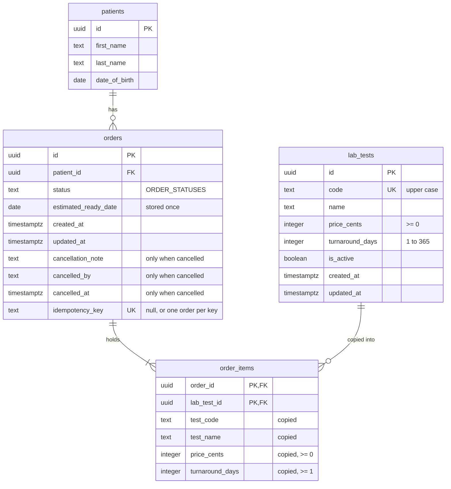

# Data model

The database tables, their columns and the rules the database itself enforces.

Each task that adds a table documents it here.

## Diagram

There is no total column anywhere: an order's total is always worked out from its items.

## Tables

### `schema_migrations`

The migration runner's bookkeeping: one row per applied file in `db/migrations/`. The runner creates it if it is missing.

| Column | Type | Rules |
|---|---|---|
| `filename` | `text` | Primary key. The migration file's name, for example `0001_baseline.sql`. |
| `applied_at` | `timestamptz` | Not null, defaults to `now()`. |

### `lab_tests`

The lab test catalog (LAB-06, migration `0002_lab_tests.sql`). Tests are never deleted, only deactivated (LAB-07), because orders point at them.

| Column | Type | Rules |
|---|---|---|
| `id` | `uuid` | Primary key, generated by the database (`gen_random_uuid()`). |
| `code` | `text` | Not null, unique (`lab_tests_code_key`), upper case (`lab_tests_code_upper`: `code = upper(code)`), not blank. |
| `name` | `text` | Not null, not blank. |
| `price_cents` | `integer` | Not null, `>= 0` (`lab_tests_price_cents_not_negative`). Whole cents. |
| `turnaround_days` | `integer` | Not null, 1 to 365 (`lab_tests_turnaround_days_range`). Business days; the cap keeps the ready-date arithmetic (LAB-11) on sane numbers. |
| `is_active` | `boolean` | Not null, defaults to `true`. |
| `created_at`, `updated_at` | `timestamptz` | Not null, default `now()`. |

The request schema (`src/shared/lab-tests.ts`) checks the same rules and more (a code of 2 to 20 letters, digits or hyphens, a name of up to 100 characters), so a user gets a clear 400 before the database is reached. The database checks are the backstop for anything that writes rows another way. Because the schema upper-cases the code and the table only holds upper-case codes, the unique constraint makes codes unique regardless of letter case: `cbc` and `CBC` are the same code. A duplicate is found by that constraint, never by a select before the insert: two requests at once would both pass the select.

**Code is immutable, unique, and tests are never deleted (LAB-07).** A test's code never changes after it is created. That rule is enforced by the API only: the update schema (`updateLabTestBody`) does not accept `code`, so `PATCH /api/lab-tests/:id` refuses it with a 400. A trigger blocking code changes was judged more machinery than the rule needs, because the API is the only writer. Uniqueness is enforced by the database (`lab_tests_code_key`). There is no delete: a test is deactivated (`is_active = false`) instead, because order items will point at it (LAB-11, LAB-12). An inactive test stays in the catalog list and keeps its orders; it is only not offered on new orders (LAB-12). There is no trigger for `updated_at`: the update's SQL sets `updated_at = now()` itself.

Seed: 8 active tests with fixed ids (`db/seeds/lab-tests.ts`): A1C, CBC, CMP, CULT, LIPID, TSH, UA, VITD.

### `patients`

One row per patient (`db/migrations/0003_patients.sql`).

| Column | Type | Rules |
|---|---|---|
| `id` | `uuid` | Primary key, `gen_random_uuid()` by default. |
| `first_name`, `last_name` | `text` | Not null, not blank. |
| `date_of_birth` | `date` | Not null, `date_of_birth <= current_date + 1`. |
| `email` | `text` | Null when absent. Lower case (`email = lower(email)`). |
| `phone` | `text` | Null when absent. A US number as exactly 10 digits, area code first (`phone ~ '^[0-9]{10}$'`). |
| `created_at`, `updated_at` | `timestamptz` | Not null, `now()` by default. |

Every check is named (`patients_contact_required` for `email is not null or phone is not null`, `patients_phone_ten_digits`, `patients_email_lower_case`, `patients_first_name_not_blank`, `patients_last_name_not_blank`, `patients_date_of_birth_not_future`), so code can tell which one a violation broke.

- **An edit is one `UPDATE ... RETURNING`, and `patients_contact_required` decides the contact rule.** `PATCH /api/patients/:id` sets only the fields sent, plus `updated_at = now()`. It does not read the patient first: if the change would leave neither email nor phone, the check refuses the row, nothing changes, and the server returns 422 `CONTACT_REQUIRED`. A read, then a check in code, then a write would leave a gap in which another edit could remove the other contact.
- **Name search has no index.** `GET /api/patients?q=` is `(first_name || ' ' || last_name) ilike '%' || q || '%'`; a pattern that starts with `%` cannot use a b-tree index, and a clinic's patient table is small enough to scan. A `pg_trgm` index is the step to take if it grows (no migration in LAB-09).

- **Date of birth is a `date`, read and written as a `YYYY-MM-DD` string.** It is a calendar day, not a moment. As a JavaScript `Date` it would be midnight UTC, which is the evening before anywhere in the Americas, so a birthday shown with local `Date` methods would move back a day.
- **Phone is stored as digits and email in lower case**, so the same number or address typed differently (`(801) 555-0100` and `801.555.0100`, `Jane@Example.test` and `jane@example.test`) is stored the same: a phone as its 10 digits (a leading US country code 1 is dropped), shown on screen as `(801) 555-0100` by `formatPhone` in `src/shared/phone.ts`. The duplicate warning (LAB-10) compares them as stored. Numbers outside the US are not supported (an owner decision).
- **Two places enforce the rules.** The shared schema gives the user a clear error per field; the database checks are the backstop for any row that does not come through the API (a script, direct SQL, a future bug).
- **The date-of-birth check is loose on purpose.** "Not in the future" means not after the clinic's today, checked in the schema with `CLINIC_TIMEZONE`. The database's `current_date` is in UTC, which can be a day ahead of or behind the clinic, so its check is `date_of_birth <= current_date + 1`: it rejects only dates that are in the future everywhere, and never a date the schema accepts. The lower limit, 1900-01-01, is checked in the schema only (`EARLIEST_DATE_OF_BIRTH` in `src/shared/patients.ts`); the database has no lower bound, so a row written directly can be older.
- No unique constraint: two patients with the same details can both exist (LAB-10 warns instead of blocking).
- **Three indexes serve the duplicate warning** (`db/migrations/0005_patient_duplicate_indexes.sql`, LAB-10): `patients_email_lower_idx` on `lower(email)`, `patients_phone_idx` on `phone`, and `patients_name_dob_idx` on (`lower(first_name)`, `lower(last_name)`, `date_of_birth`), one per rule of the candidate query (`findDuplicateCandidates` in `src/server/patients/repo.ts`), each on the expression it compares. They are plain, not unique: the rule warns and never blocks. Every create runs the query, so they keep it a lookup as the table grows; at a clinic's few hundred rows Postgres scans the table anyway.

### `orders`

One row per order (LAB-11, `db/migrations/0004_orders.sql`). Orders are never deleted: a cancelled order keeps its row (LAB-17).

| Column | Type | Rules |
|---|---|---|
| `id` | `uuid` | Primary key, `gen_random_uuid()` by default. |
| `patient_id` | `uuid` | Not null, references `patients`. A patient with orders cannot be deleted. |
| `status` | `text` | Not null, `ordered` by default, one of `ordered`, `collected`, `completed`, `cancelled` (`orders_status_known`). |
| `estimated_ready_date` | `date` | Not null. Worked out once by `estimateReadyDate` when the order is placed, then stored. The rule: the ready date is the Nth business day after the day the order was placed (in `CLINIC_TIMEZONE`), where N is the longest turnaround among the order's tests. Saturday and Sunday are not business days. The order day itself is never counted. |
| `created_at`, `updated_at` | `timestamptz` | Not null, `now()` by default. Placing an order (LAB-12) sets `created_at` from the same clock reading that gave the ready date. A status change (LAB-16) and a cancel (LAB-17) set `updated_at = now()` in their conditional update; there is no trigger. |
| `cancellation_note` | `text` | Why the order was cancelled (LAB-17, `db/migrations/0007_order_cancellation.sql`). Null unless cancelled. |
| `cancelled_by` | `text` | The name typed by the person who cancelled it (there is no login). Null unless cancelled. |
| `cancelled_at` | `timestamptz` | When it was cancelled, set to `now()` by the same update as the status. Null unless cancelled. |
| `idempotency_key` | `text` | Null when absent (`db/migrations/0008_orders_idempotency_key.sql`, LAB-18). The browser's random key (a uuid, stored in lower case) for one attempt to place an order, from the `Idempotency-Key` header of `POST /api/orders`. Unique (`orders_idempotency_key`); nulls are distinct, so any number of orders have none (every order placed before LAB-18, and every request sent without a key). |

The CHECK `orders_cancellation_complete` ties the three to the status: when `status = 'cancelled'` all three are non-null and the note and the name are not blank (`btrim(...) <> ''`, which trims spaces); for any other status all three are null. The API trims and checks the note and the name first (`cancelOrderBody` in `src/shared/orders.ts`); the CHECK is the backstop for a row written any other way, so a cancelled order without its reason or its name cannot exist. Because the CHECK is not deferred, the cancel sets the status and the three fields in one `UPDATE`.

Three indexes serve the list (`GET /api/orders`), one per filter, each ending in the list's own order (`created_at desc`, `id desc`) so Postgres reads the rows already sorted and stops after `limit + 1`:

| Index | Columns | Query it serves |
|---|---|---|
| `orders_created_at_id` (0004) | `created_at desc`, `id desc` | No filter: `order by created_at desc, id desc limit n`. |
| `orders_status_created_at_id` (0006) | `status`, `created_at desc`, `id desc` | The status filter: `where status = $1 order by created_at desc, id desc`. |
| `orders_patient_id_created_at_id` (0006) | `patient_id`, `created_at desc`, `id desc` | The patient filter (and, in LAB-19, the patient page's order history): `where patient_id = $1 order by ...`. Both filters together use this one too: a patient has few orders, so checking the status on them is cheap. |

Without them each filtered page would read and sort every order as the table grows. The list query cuts the page from `orders` alone (filter, order, `limit`, `offset`) before it joins the patients and items, so Postgres can read that page from the filter's index and stop after `limit + 1` rows; joining and grouping first would force it to aggregate every matching order. On 50,000 orders with 100,000 items, `explain analyze` showed each filter reading its own index and returning 26 rows in under a millisecond (the patient-and-status pair about 8 ms); on a table of a few dozen rows, as in the seed, Postgres prefers a plain scan, which is just as fast.

- **One order per idempotency key (LAB-18).** Placing an order first looks the key up (`findOrderIdByIdempotencyKey`) and answers a repeat with the earlier order (200) before checking anything. That select cannot stop a race, since two requests can both find nothing; the unique index `orders_idempotency_key` does: the insert is `on conflict (idempotency_key) do nothing returning id`, so of two requests with the same key at the same moment, the second one's insert waits for the first transaction, then finds the conflict, inserts nothing and returns the first one's order. The index is not partial (`where idempotency_key is not null`), because `on conflict (idempotency_key)` needs a plain unique index on the column. A key never expires and is not tied to a user: the limits of this version (`docs/plan/backlog.md`).
- **The statuses are written in two places only:** `ORDER_STATUSES` in `src/shared/orders.ts`, from which every schema and screen label derives, and the CHECKs above (`orders_cancellation_complete` names `cancelled` too). An integration test reads the definition of `orders_status_known` and asserts it lists exactly `ORDER_STATUSES`, in order; `orders_cancellation_complete` is covered by its own reject/accept tests. To add a status, follow "Adding an order status" in `AGENTS.md`.
- **The total is derived, the ready date is stored.** The total is the sum of the items' frozen prices, so it can never disagree with them, and storing it would only add a copy that could. The ready date depends on the moment the order was placed and on the clinic's calendar; working it out again later would need that moment and the same rule version, and a change to the rule (holidays, say) must not move the date of an order already promised to a patient.
- **"At least one item" is not a database rule.** A CHECK cannot look at other rows, and a trigger would be the only way. Placing an order (LAB-12) refuses an empty test list with a 422 before anything is written, and `estimateReadyDate` throws on an empty list, so the service cannot store an order without items. An order written by hand with no items still shows in the list, as 0 tests and $0.00.

### `order_items`

One row per test on an order (LAB-11). Each row is a snapshot: the test's code, name, price and turnaround are copied from `lab_tests` when the order is placed, so editing or deactivating a test later (LAB-07) never changes an order that already exists.

| Column | Type | Rules |
|---|---|---|
| `order_id` | `uuid` | Not null, references `orders`. |
| `lab_test_id` | `uuid` | Not null, references `lab_tests`. A test that has been ordered cannot be deleted (tests are deactivated instead). |
| `test_code`, `test_name` | `text` | Not null. Copied from the test. |
| `price_cents` | `integer` | Not null, `>= 0` (`order_items_price_cents_not_negative`). Copied from the test; the price the order was quoted. |
| `turnaround_days` | `integer` | Not null, `>= 1` (`order_items_turnaround_days_positive`). Copied from the test. |

The primary key (`order_items_pkey`) is (`order_id`, `lab_test_id`), so a test appears at most once on an order. The rows have no id of their own.

Seed (`db/seeds/orders.ts`): 4 orders for seeded patients with fixed ids `5eed0011-0000-4000-8000-00000000000N`, statuses `ordered` (two), `collected` and `completed`, with 1, 3, 2 and 3 items. Each order has a fixed order time, one of them Friday 2026-10-30 at 12:00 in Denver. The seed reads each test from `lab_tests` and copies it onto the item, and stores the ready date `estimateReadyDate` gives for that fixed time in `CLINIC_TIMEZONE`, so it never depends on when the seed runs. No order is seeded as `cancelled`; cancel one from its panel to see one (the CHECK above requires a seeded cancelled order to carry a note, a name and a time).

## Rules for every table

- **Calendar days are `date` columns, read as `YYYY-MM-DD` strings.** A date of birth or a ready date is a day, not a moment. The `DATE` type parser (`src/server/db/types.ts`) keeps Postgres's string as it is; without it, `pg` would build a JavaScript `Date` at local midnight, and the day could shift depending on the server's time zone.
- **A `date[]` (for example from `array_agg`) still comes back as JavaScript `Date`s**, because only the single `DATE` type has a parser. Select dates one per row instead.
- **Money is whole cents in integer columns** (`price_cents`, `total_cents`).
