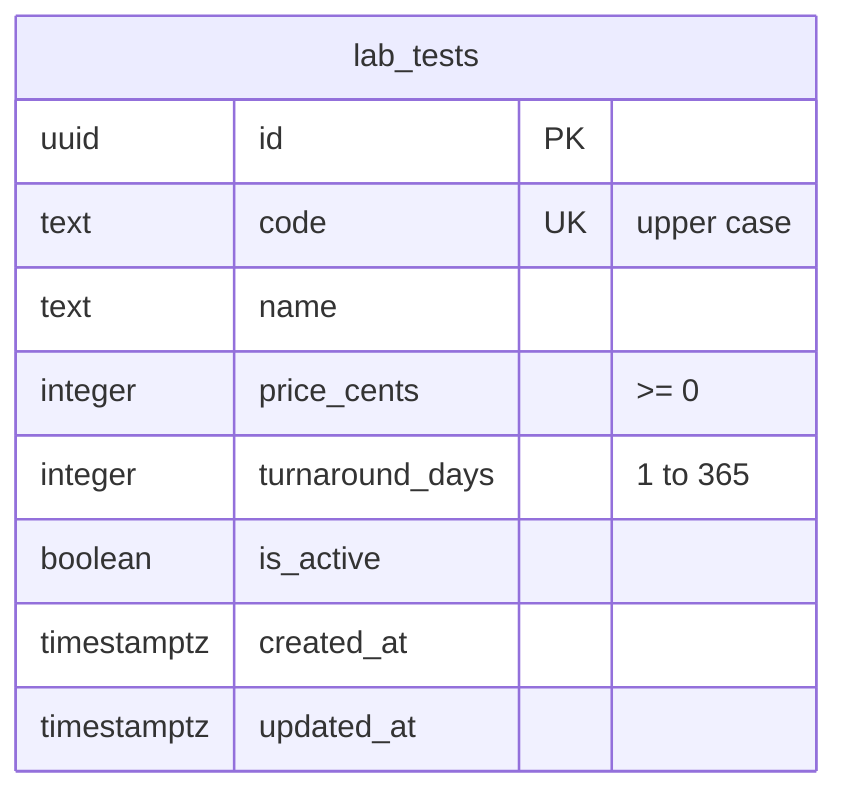

# Data model

The database tables, their columns and the rules the database itself enforces.

Each task that adds a table documents it here.

## Diagram

## Tables

### `schema_migrations`

The migration runner's bookkeeping: one row per applied file in `db/migrations/`. The runner creates it if it is missing.

| Column | Type | Rules |
|---|---|---|
| `filename` | `text` | Primary key. The migration file's name, for example `0001_baseline.sql`. |
| `applied_at` | `timestamptz` | Not null, defaults to `now()`. |

### `lab_tests`

The lab test catalog (LAB-06, migration `0002_lab_tests.sql`). Tests are never deleted, only deactivated (LAB-07), because orders point at them.

| Column | Type | Rules |
|---|---|---|
| `id` | `uuid` | Primary key, generated by the database (`gen_random_uuid()`). |
| `code` | `text` | Not null, unique (`lab_tests_code_key`), upper case (`lab_tests_code_upper`: `code = upper(code)`), not blank. |
| `name` | `text` | Not null, not blank. |
| `price_cents` | `integer` | Not null, `>= 0` (`lab_tests_price_cents_not_negative`). Whole cents. |
| `turnaround_days` | `integer` | Not null, 1 to 365 (`lab_tests_turnaround_days_range`). Business days; the cap keeps the ready-date arithmetic (LAB-11) on sane numbers. |
| `is_active` | `boolean` | Not null, defaults to `true`. |
| `created_at`, `updated_at` | `timestamptz` | Not null, default `now()`. |

The request schema (`src/shared/lab-tests.ts`) checks the same rules and more (a code of 2 to 20 letters, digits or hyphens, a name of up to 100 characters), so a user gets a clear 400 before the database is reached. The database checks are the backstop for anything that writes rows another way. Because the schema upper-cases the code and the table only holds upper-case codes, the unique constraint makes codes unique regardless of letter case: `cbc` and `CBC` are the same code. A duplicate is found by that constraint, never by a select before the insert: two requests at once would both pass the select.

Seed: 8 active tests with fixed ids (`db/seeds/lab-tests.ts`): A1C, CBC, CMP, CULT, LIPID, TSH, UA, VITD.

### `patients`

One row per patient (`db/migrations/0003_patients.sql`).

| Column | Type | Rules |
|---|---|---|
| `id` | `uuid` | Primary key, `gen_random_uuid()` by default. |
| `first_name`, `last_name` | `text` | Not null, not blank. |
| `date_of_birth` | `date` | Not null, `date_of_birth <= current_date + 1`. |
| `email` | `text` | Null when absent. Lower case (`email = lower(email)`). |
| `phone` | `text` | Null when absent. A US number as exactly 10 digits, area code first (`phone ~ '^[0-9]{10}$'`). |
| `created_at`, `updated_at` | `timestamptz` | Not null, `now()` by default. |

Every check is named (`patients_contact_required` for `email is not null or phone is not null`, `patients_phone_ten_digits`, `patients_email_lower_case`, `patients_first_name_not_blank`, `patients_last_name_not_blank`, `patients_date_of_birth_not_future`), so code can tell which one a violation broke (LAB-09 maps `patients_contact_required` to a 422).

- **Date of birth is a `date`, read and written as a `YYYY-MM-DD` string.** It is a calendar day, not a moment. As a JavaScript `Date` it would be midnight UTC, which is the evening before anywhere in the Americas, so a birthday shown with local `Date` methods would move back a day.
- **Phone is stored as digits and email in lower case**, so the same number or address typed differently (`(801) 555-0100` and `801.555.0100`, `Jane@Example.test` and `jane@example.test`) is stored the same: a phone as its 10 digits (a leading US country code 1 is dropped), shown on screen as `(801) 555-0100` by `formatPhone` in `src/shared/phone.ts`. The duplicate warning (LAB-10) compares them as stored. Numbers outside the US are not supported (an owner decision).
- **Two places enforce the rules.** The shared schema gives the user a clear error per field; the database checks are the backstop for any row that does not come through the API (a script, direct SQL, a future bug).
- **The date-of-birth check is loose on purpose.** "Not in the future" means not after the clinic's today, checked in the schema with `CLINIC_TIMEZONE`. The database's `current_date` is in UTC, which can be a day ahead of or behind the clinic, so its check is `date_of_birth <= current_date + 1`: it rejects only dates that are in the future everywhere, and never a date the schema accepts.
- No unique constraint: two patients with the same details can both exist (LAB-10 warns instead of blocking).

## Rules for every table

- **Calendar days are `date` columns, read as `YYYY-MM-DD` strings.** A date of birth or a ready date is a day, not a moment. The `DATE` type parser (`src/server/db/types.ts`) keeps Postgres's string as it is; without it, `pg` would build a JavaScript `Date` at local midnight, and the day could shift depending on the server's time zone.
- **A `date[]` (for example from `array_agg`) still comes back as JavaScript `Date`s**, because only the single `DATE` type has a parser. Select dates one per row instead.
- **Money is whole cents in integer columns** (`price_cents`, `total_cents`).
