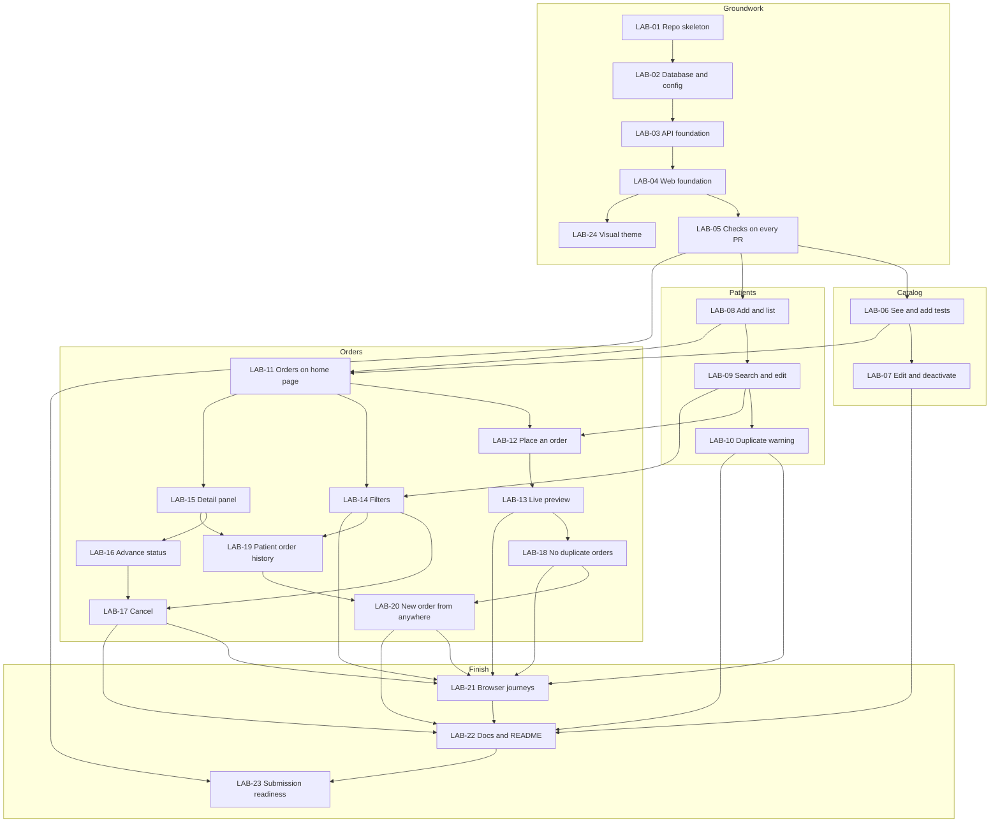

# Lab Orders Lite: build plan

This is the plan for building the app in small, shippable steps, written the way a team would plan work it wants in production quickly and safely. This page is the board: the list of tasks, their status, and how they depend on each other. Each task has its own ticket file in [tasks/](tasks/), with a description, requirements, acceptance criteria and dependencies.

The decisions these tasks implement are in the process log (`docs/process.md` once in the repo).

## How the work flows

- **One task, one branch, one pull request.** Each task is a feature branch off `main`, merged after review. `main` works after every merge.
- **Groundwork first, then vertical slices.** The first five tasks set up the project. After that, almost every task delivers something a user can see or do, from the database to the screen.
- **"Shipped" means:** merged to `main`, all checks green, and the app runs from a fresh clone with `pnpm install` then `pnpm dev`.
- **Who does what:** the AI writes the code. I review every pull request, and nothing merges until I can explain it.
- **A check-in before every ticket.** No ticket starts until the AI has walked me through it and I have said go. In the check-in I review the ticket, make sure I understand what will be built and why, and give feedback and direction. Changes I ask for are written into the ticket before work begins.

### The loop for each ticket

1. **Check-in.** The AI summarises the ticket in plain language: what it delivers, how it will be built, the decisions inside it, and anything it is unsure about. I ask questions and adjust.
2. **Go.** I approve the ticket, with any changes recorded in it.
3. **Build.** The AI works on a feature branch, with tests.
4. **Walkthrough.** The AI shows me what was built, how a request flows through it, and the test results. I answer the ticket's "What to be able to explain" questions.
5. **Merge.** I approve the pull request, and the process log gets its entry.

### How reviews work

- **One independent review per ticket.** Every ticket is reviewed once, by a session that did not build it, before it is pushed.
- **The depth matches the risk.** The tickets that hold the business rules and data integrity (LAB-10, LAB-11, LAB-12, LAB-16, LAB-17, LAB-18) get a full review, which includes breaking the code on purpose to check that the tests notice. The rest get a light review: the acceptance criteria reproduced; the diff read against three priorities, which are correct rules, no patient data in logs, and a fresh clone that works; and that ticket's new rules broken a few ways.
- **Only what must or should be fixed is fixed.** Optional findings go to the [backlog](backlog.md).
- **The automated checks** on every pull request cover lint, types, formatting, the build and all tests except the browser tests, which run locally (LAB-05).

The first four tickets were reviewed more heavily than this; the process was simplified deliberately once the groundwork was in place.

### Definition of done, for every task

- Every acceptance criterion in the ticket passes.
- Tests for the new behaviour are written in the same pull request, each rule tested in one layer only.
- Docs are updated if the data model, API or architecture changed.
- The slice's manual checks are added to the acceptance checklist, under the browser checkpoint that covers it (see below).
- The slice is recorded in the process log: what was asked for, what I rejected or changed, and why.
- I can answer the "What to be able to explain" questions in the ticket.

**The process log, for now.** The process log is kept outside the repository for now. Where a ticket says its `docs/process.md` entry is written in the same pull request, the entry is written to that log at the same time. The log will be added to the repository when I choose.

## The tasks

| ID | Task | Type | Depends on | Status |
|---|---|---|---|---|
| [LAB-01](tasks/LAB-01-repo-skeleton-and-tooling.md) | Repo skeleton and tooling | Groundwork | — | Done |
| [LAB-02](tasks/LAB-02-database-and-config.md) | Database, migrations and config | Groundwork | LAB-01 | Done |
| [LAB-03](tasks/LAB-03-api-foundation.md) | API foundation: server, logging, errors, health | Groundwork | LAB-02 | Done |
| [LAB-04](tasks/LAB-04-web-foundation.md) | Web foundation: app shell and navigation | Groundwork | LAB-03 | Done |
| [LAB-05](tasks/LAB-05-continuous-integration.md) | Checks on every pull request | Groundwork | LAB-04 | Done |
| [LAB-06](tasks/LAB-06-catalog-list-and-add.md) | Catalog: see and add lab tests | Vertical slice | LAB-05 | Not started |
| [LAB-07](tasks/LAB-07-catalog-edit-and-deactivate.md) | Catalog: edit and activate or deactivate tests | Vertical slice | LAB-06 | Not started |
| [LAB-08](tasks/LAB-08-patients-create-and-list.md) | Patients: add and list patients | Vertical slice | LAB-05 | Not started |
| [LAB-09](tasks/LAB-09-patients-search-and-edit.md) | Patients: search by name and edit a patient | Vertical slice | LAB-08 | Not started |
| [LAB-10](tasks/LAB-10-patients-duplicate-warning.md) | Patients: duplicate warning on create | Vertical slice | LAB-09 | Not started |
| [LAB-11](tasks/LAB-11-orders-home-page.md) | Orders: see orders on the home page | Vertical slice | LAB-06, LAB-08 | Not started |
| [LAB-12](tasks/LAB-12-orders-place-an-order.md) | Orders: place an order | Vertical slice | LAB-09, LAB-11 | Not started |
| [LAB-13](tasks/LAB-13-orders-live-preview.md) | Orders: live total and ready date while building an order | Vertical slice | LAB-12 | Not started |
| [LAB-14](tasks/LAB-14-orders-list-filters.md) | Orders: filter the list by status and patient | Vertical slice | LAB-09, LAB-11 | Not started |
| [LAB-15](tasks/LAB-15-orders-detail-panel.md) | Orders: order detail slide-out panel | Vertical slice | LAB-11 | Not started |
| [LAB-16](tasks/LAB-16-orders-advance-status.md) | Orders: mark an order collected or completed | Vertical slice | LAB-15 | Not started |
| [LAB-17](tasks/LAB-17-orders-cancel.md) | Orders: cancel an order with a note and a name | Vertical slice | LAB-14, LAB-16 | Not started |
| [LAB-18](tasks/LAB-18-orders-idempotent-create.md) | Orders: a double-click or retry cannot create a duplicate order | Hardening | LAB-13 | Not started |
| [LAB-19](tasks/LAB-19-patient-order-history.md) | Patient page: order history | Vertical slice | LAB-14, LAB-15 | Not started |
| [LAB-20](tasks/LAB-20-new-order-entry-points.md) | New order from the menu bar and the patient page | Vertical slice | LAB-18, LAB-19 | Not started |
| [LAB-21](tasks/LAB-21-browser-journeys.md) | Browser tests for the main journeys | Hardening | LAB-10, LAB-13, LAB-14, LAB-17, LAB-18, LAB-20 | Not started |
| [LAB-22](tasks/LAB-22-docs-and-readme.md) | Docs and README, final pass | Docs | LAB-07, LAB-10, LAB-17, LAB-20, LAB-21 | Not started |
| [LAB-23](tasks/LAB-23-submission-readiness.md) | Submission readiness | Hardening | LAB-05, LAB-22 | Not started |
| [LAB-24](tasks/LAB-24-visual-theme.md) | Visual theme | Groundwork | LAB-04 | Done |

## How the tasks depend on each other

An arrow means "must be merged before".

## Browser checkpoints

Automated tests guard what must not break. At three points in the build, the AI also runs an exploratory pass in a real browser, following `docs/acceptance-checklist.md`, to find what a script would not think to check. Every bug it finds gets a failing automated test before it is fixed, on its own branch, and the run is recorded in the process log.

| Checkpoint | Runs | Covers | What is tested |
|---|---|---|---|
| 1 | Once LAB-04 and LAB-06 to LAB-12 have all merged | App start and menu, catalog, patients, orders home page, placing an order | Adding and editing tests; deactivated tests cannot be ordered; patient form errors; date of birth shown correctly; the duplicate warning and both ways out of it; quick-add by keyboard; an order appears with the right total and ready date; error messages show a request id |
| 2 | Once LAB-13 to LAB-17 have all merged | Live preview, filters, detail panel, status changes, cancel | Total and ready date update as tests are added and match the saved order; filters and the back button; the panel opens from a link; only allowed status buttons appear; cancel needs a note and a name; a completed order cannot be cancelled; two tabs changing the same order |
| 3 | In LAB-23 | Everything, including no duplicate orders, patient order history, New order from every entry point | The full checklist from a fresh clone; double-clicking submit; New order from the menu bar, the orders page and a patient page; keyboard-only use; empty, loading and error states on every page |

Each ticket adds its own checks to the checklist section for its checkpoint, so the list of what to test is written as the features are built.

## Suggested order

Tasks on the same line do not depend on each other and could be built in parallel by a team. Working alone, I take them left to right.

Up to three tickets may be built at the same time where the dependency diagram allows, each in its own working copy with its own database (README, "Running a second copy"), and merged one at a time.

1. LAB-01 → LAB-02 → LAB-03 → LAB-04 → LAB-05 (groundwork)
2. LAB-06, LAB-08 (first things a user can see: the catalog and patients)
3. LAB-07, LAB-09
4. LAB-10, LAB-11 (orders appear on the home page)
5. LAB-12 (the core of the app: place an order)
6. LAB-13, LAB-14, LAB-15
7. LAB-16, LAB-18, LAB-19
8. LAB-17, LAB-20
9. LAB-21 → LAB-22 → LAB-23

Improvements deliberately not taken, from reviews and elsewhere, are listed in the [backlog](backlog.md).

An independent review of this plan, done before any code was written, is in [REVIEW.md](REVIEW.md). Its corrections are applied to the tickets; the decisions I made on its open questions are in the process log.

The first point at which the brief's core is met (patients, a catalog, an order with a total and ready date, a list) is after LAB-12. Everything from there on makes it better without being needed for it to work.

## What is deliberately not in this plan

Login and roles, editing an order after it is placed, public holidays and cut-off times, status and results per test, voiding a completed order, pasting a list of tests, AI features in the running app, tracing, metrics and alerting, browser tests in the automated checks, and mobile and narrow-screen layouts (desktop only). Each is listed with its reason in the process log.
